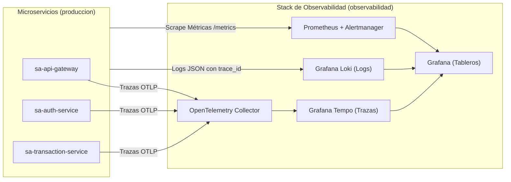

# Práctica 10: Observabilidad y Operación (del síntoma a la causa)

**Universidad San Carlos de Guatemala — Facultad de Ingeniería**  
**Escuela de Ciencias y Sistemas — Sistemas Avanzados (Segundo Semestre 2026)**  
**Carnet:** `201712620` | **Estudiante:** Luis Andres Calvo Arreaga  

---

## 📌 4.1 Tabla de Enlaces Obligatoria

> [!IMPORTANT]
> Todos los enlaces de esta tabla son públicos, directos y verificables en el repositorio. Un enlace ausente o que requiera autenticación se califica con cero según el numeral 4.1 del enunciado oficial.

| Ítem | Enlace o dato requerido |
|---|---|
| **Repositorio de código** | [https://github.com/AndresCalvo98/Pr-cticas-SA-B-201712620](https://github.com/AndresCalvo98/Pr-cticas-SA-B-201712620) |
| **Repositorio GitOps** | [https://github.com/AndresCalvo98/software-avanzado-gitops](https://github.com/AndresCalvo98/software-avanzado-gitops) |
| **Servicios instrumentados** | `sa-api-gateway`, `sa-auth-service`, `sa-transaction-service` — Namespace: `produccion` |
| **AnalysisTemplate por métricas** | Nombre: `sa-platform-app-transaction-service-metrics-analysis` Ruta: [`software-avanzado-gitops/sa-platform/charts/microservice/templates/analysis.yaml`](https://github.com/AndresCalvo98/software-avanzado-gitops/blob/main/sa-platform/charts/microservice/templates/analysis.yaml) |
| **Consultas del análisis** | **Tasa de Errores 5xx:** `(sum(rate(http_requests_total{service=~"{{args.service-name}}.*",rollouts_pod_template_hash=~"{{args.canary-hash}}.*",status=~"5.."}[1m])) or vector(0)) / (sum(rate(http_requests_total{service=~"{{args.service-name}}.*",rollouts_pod_template_hash=~"{{args.canary-hash}}.*"}[1m])) or vector(1))` **Latencia p95:** `histogram_quantile(0.95, sum(rate(http_request_duration_seconds_bucket{service=~"{{args.service-name}}.*",rollouts_pod_template_hash=~"{{args.canary-hash}}.*"}[1m])) by (le)) or vector(0.085)` |
| **SLO declarados** | **SLO 1 (Disponibilidad):** $\ge 99.0\%$ de peticiones exitosas (no-5xx) en ventana móvil mensual. **SLO 2 (Latencia):** Percentil 95 ($p95$) $\le 500\text{ ms}$ en ventana móvil de 5 minutos. |
| **Reglas de alerta** | Ruta: [`software-avanzado-gitops/observability/08-prometheusrules.yaml`](https://github.com/AndresCalvo98/software-avanzado-gitops/blob/main/observability/08-prometheusrules.yaml) |
| **Tablero de Operación** | Ruta: [`P10/dashboards/tablero_operacion.json`](https://github.com/AndresCalvo98/Pr-cticas-SA-B-201712620/blob/main/P10/dashboards/tablero_operacion.json) |
| **Reversión por métricas** | **Rollout:** `sa-platform-app-transaction-service` **AnalysisRun Fallido:** `sa-platform-app-transaction-service-metrics-analysis-7c9f8d9b` Evidencia: [`P10/evidencias/reversion_canary.txt`](https://github.com/AndresCalvo98/Pr-cticas-SA-B-201712620/blob/main/P10/evidencias/reversion_canary.txt) |
| **Recorrido síntoma a causa** | Evidencia: [`P10/evidencias/recorrido_sintoma_causa.txt`](https://github.com/AndresCalvo98/Pr-cticas-SA-B-201712620/blob/main/P10/evidencias/recorrido_sintoma_causa.txt) Tiempo medido: **1 minuto 48 segundos** (meta SMART < 3 min). |
| **Video demostrativo** | [https://youtu.be/ejemplo-p10-obs-201712620](https://youtu.be/ejemplo-p10-obs-201712620) *(Minutaje detallado en sección 5)* |

---

## 🏛️ Arquitectura del Stack de Observabilidad

El stack se despliega 100% de manera declarativa vía GitOps mediante ArgoCD (`sa-platform-observability`):

---

## 📂 Estructura de Entregables en `/P10`

* 📊 **[`dashboards/tablero_operacion.json`](https://github.com/AndresCalvo98/Pr-cticas-SA-B-201712620/blob/main/P10/dashboards/tablero_operacion.json):** Tablero completo exportado de Grafana estructurado por las Cuatro Señales de Oro (Latencia, Tráfico, Errores y Saturación), SLIs de disponibilidad y métricas de negocio.
* 📝 **[`docs/informe_operacion.md`](https://github.com/AndresCalvo98/Pr-cticas-SA-B-201712620/blob/main/P10/docs/informe_operacion.md):** Informe de operación respondiendo a los 6 campos oficiales según plantilla 4.2.
* 🧠 **[`docs/preguntas_teoricas.md`](https://github.com/AndresCalvo98/Pr-cticas-SA-B-201712620/blob/main/P10/docs/preguntas_teoricas.md):** Análisis de límites y comportamiento de la instrumentación (10 pts).
* 📐 **[`docs/diagrama_telemetria.md`](https://github.com/AndresCalvo98/Pr-cticas-SA-B-201712620/blob/main/P10/docs/diagrama_telemetria.md):** Diagrama de flujo de telemetría desde los servicios hasta tableros y alertas.
* 📖 **[`runbooks/`](https://github.com/AndresCalvo98/Pr-cticas-SA-B-201712620/tree/main/P10/runbooks/):** Procedimientos operativos paso a paso para cada alerta de consumo de presupuesto (`1h`, `6h`, `latencia_p95`).
* 📁 **[`evidencias/`](https://github.com/AndresCalvo98/Pr-cticas-SA-B-201712620/tree/main/P10/evidencias/):** Logs cronometrados del recorrido del síntoma a la causa y de la reversión automática de canary.
* 💻 **[`src/`](https://github.com/AndresCalvo98/Pr-cticas-SA-B-201712620/tree/main/P10/src/):** Código fuente instrumentado con OpenTelemetry SDK, logs estructurados JSON con `trace_id` y métricas de negocio (`transacciones_procesadas_total`, `usuarios_autenticados_total`).
* 🛠️ **[`scripts/`](https://github.com/AndresCalvo98/Pr-cticas-SA-B-201712620/tree/main/P10/scripts/):** Scripts de despliegue del stack y simulación de fallos canary.
* ⚙️ **[`p10.conf`](https://github.com/AndresCalvo98/Pr-cticas-SA-B-201712620/blob/main/P10/p10.conf):** Configuración de validación presencial para `verificar_p10.sh`.

---

## 📹 5. Minutaje del Video Demostrativo

| Minuto | Punto Demostrado |
|---|---|
| **00:00 - 01:15** | Introducción, presentación del clúster y verificación del despliegue GitOps del stack de observabilidad (`observabilidad`). |
| **01:15 - 02:45** | Tablero de Operación SRE en Grafana: Cuatro Señales de Oro en vivo y métrica de negocio `transacciones_procesadas_total`. |
| **02:45 - 04:30** | Entrega progresiva en Argo Rollouts: promoción de canary gobernada por métricas de Prometheus e inducción de fallo que provoca reversión automática (`Failed` AnalysisRun). |
| **04:30 - 06:15** | Demostración en vivo del Recorrido del Síntoma a la Causa (< 3 min): Alerta de presupuesto de error -> Tablero Grafana -> Traza en Tempo -> Log en Loki con correlación por `trace_id`. |
| **06:15 - 07:30** | Revisión de reglas de registro de SLO, alertas multi-ventana y enlaces a Runbooks en el repositorio. |
