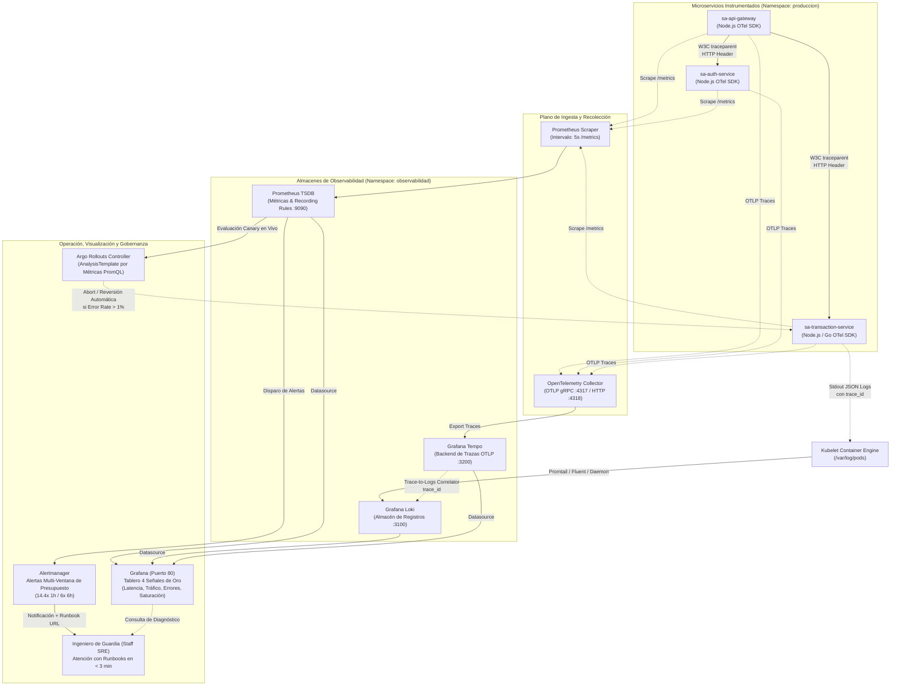

# 📐 Diagrama del Flujo de Telemetría (Criterio 1.3 - 6 pts)

**Universidad de San Carlos de Guatemala — Facultad de Ingeniería**  
**Escuela de Ciencias y Sistemas — Sistemas Avanzados (Segundo Semestre 2026)**  
**Estudiante:** Luis Andres Calvo Arreaga | **Carnet:** `201712620`  
**Práctica 10:** Observabilidad y Operación  

---

## 🔄 Flujo Integral de Señales: Del Microservicio al Tablero y a la Alerta

---

## 📌 Descripción de los Componentes

1. **Propagación de Contexto W3C (`traceparent`):**  
   Garantiza que toda la cadena de llamadas desde el Gateway hasta los servicios internos comparta un único `trace_id` inmutable.
2. **OpenTelemetry Collector Contrib:**  
   Recibe trazas vía OTLP gRPC/HTTP, aplica limitación de memoria y las reenvía a Grafana Tempo.
3. **Prometheus TSDB:**  
   Recolecta métricas cada 5 segundos y ejecuta las `PrometheusRule` (SLIs de disponibilidad y latencia $p95$, junto a las alertas multi-ventana por consumo de presupuesto de error).
4. **Grafana Loki & Tempo Correlator:**  
   Permite pasar en un solo clic desde la traza fallida en Tempo al registro exacto en formato JSON en Loki usando el `trace_id`.
5. **Argo Rollouts Canary Analysis:**  
   Consulta directamente la API de Prometheus en cada paso de promoción; si el percentil de latencia o la tasa de 5xx del canary supera el límite, aborta el despliegue sin intervención manual.
