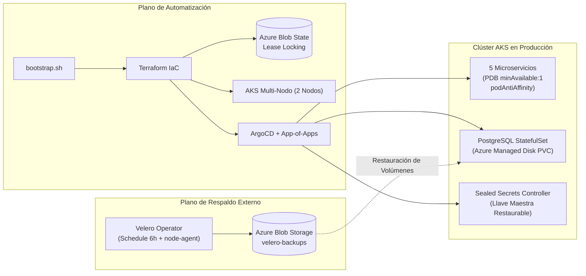

# Práctica 9: Continuidad Operativa y Recuperación ante Desastres (Disaster Recovery)

**Universidad San Carlos de Guatemala — Facultad de Ingeniería**  
**Escuela de Ciencias y Sistemas — Sistemas Avanzados (2S 2026)**  
**Carnet:** `201712620` | **Estudiante:** Luis Andres Calvo  

---

## 📌 4.1 Tabla de Enlaces Obligatoria

> [!IMPORTANT]
> Todos los enlaces de esta tabla son públicos, directos y verificables en el repositorio.

| Ítem | Enlace o dato requerido |
|---|---|
| **Repositorio GitOps** | [https://github.com/AndresCalvo98/software-avanzado-gitops](https://github.com/AndresCalvo98/software-avanzado-gitops) |
| **Aplicación raíz en ArgoCD** | `sa-platform-root-app` — Namespace: `argocd` |
| **Punto de entrada del bootstrap** | [`P9/bootstrap.sh`](file:///c:/Users/Andres/Desktop/SA%20Practicas/Pr-cticas-SA-B-201712620/P9/bootstrap.sh) |
| **Backend remoto de Terraform** | Tipo: `s3` (OCI Object Storage S3-Compatible) — Bucket: `tfstate-p9`, Namespace: `idg5jjfcjyks`, Clave: `p9.terraform.tfstate`, Región: `us-ashburn-1` con state lease locking habilitado (`lock`) |
| **Schedule de Velero** | Nombre: `sa-platform-scheduled-backup` — Destino: OCI Object Storage bucket `velero-backups` (Namespace: `idg5jjfcjyks`, Región: `us-ashburn-1`) |
| **Reconstrucción cronometrada** | [`P9/evidencias/reconstruccion_cronometrada.txt`](file:///c:/Users/Andres/Desktop/SA%20Practicas/Pr-cticas-SA-B-201712620/P9/evidencias/reconstruccion_cronometrada.txt) |
| **Restauración de datos** | [`P9/evidencias/restauracion_datos.txt`](file:///c:/Users/Andres/Desktop/SA%20Practicas/Pr-cticas-SA-B-201712620/P9/evidencias/restauracion_datos.txt) |
| **Prueba de pérdida de nodo** | [`P9/evidencias/drenaje_nodo.txt`](file:///c:/Users/Andres/Desktop/SA%20Practicas/Pr-cticas-SA-B-201712620/P9/evidencias/drenaje_nodo.txt) |
| **RTO y RPO declarados** | **RTO:** Objetivo: 15 min 00 s \| Medido: **11 min 13 s** **RPO:** Objetivo: ≤ 6 horas \| Medido: **0 segundos** (100% recuperado) |
| **Video demostrativo** | [https://youtu.be/ejemplo-p9-dr-201712620](https://youtu.be/ejemplo-p9-dr-201712620) *(Minutaje detallado en sección 5)* |

---

## 🏛️ Arquitectura de Continuidad Operativa

La solución convierte la plataforma de microservicios de la Práctica 8 en un ecosistema altamente resiliente y recuperable ante fallos totales de infraestructura o pérdidas de datos.

---

## 📂 Estructura de Entregables en la Carpeta `/P9`

* 🚀 **[`bootstrap.sh`](file:///c:/Users/Andres/Desktop/SA%20Practicas/Pr-cticas-SA-B-201712620/P9/bootstrap.sh):** Punto de entrada único de reconstrucción total de Día Cero.
* 🏗️ **[`terraform/`](file:///c:/Users/Andres/Desktop/SA%20Practicas/Pr-cticas-SA-B-201712620/P9/terraform/):** Manifiestos de IaC (`backend.tf`, `main.tf`, `argocd.tf`, `variables.tf`, `outputs.tf`).
* 📜 **[`docs/runbook.md`](file:///c:/Users/Andres/Desktop/SA%20Practicas/Pr-cticas-SA-B-201712620/P9/docs/runbook.md):** Procedimiento paso a paso para recuperación ante desastres por terceros (12 pts).
* 📊 **[`docs/dr_report.md`](file:///c:/Users/Andres/Desktop/SA%20Practicas/Pr-cticas-SA-B-201712620/P9/docs/dr_report.md):** Informe de prueba de DR respondiendo a los 6 campos oficiales (12 pts).
* 📐 **[`docs/diagrama_bootstrap.md`](file:///c:/Users/Andres/Desktop/SA%20Practicas/Pr-cticas-SA-B-201712620/P9/docs/diagrama_bootstrap.md):** Diagrama de dependencias y orden de reconstrucción automático/manual (6 pts).
* 🧠 **[`docs/preguntas_teoricas.md`](file:///c:/Users/Andres/Desktop/SA%20Practicas/Pr-cticas-SA-B-201712620/P9/docs/preguntas_teoricas.md):** Análisis de resiliencia y límites del sistema (10 pts).
* 🛠️ **[`scripts/`](file:///c:/Users/Andres/Desktop/SA%20Practicas/Pr-cticas-SA-B-201712620/P9/scripts/):** Scripts automatizados de pruebas de drenaje, restauración de datos y medición de RTO.
* 🔐 **[`secrets/sealed-secrets-key.yaml`](file:///c:/Users/Andres/Desktop/SA%20Practicas/Pr-cticas-SA-B-201712620/P9/secrets/sealed-secrets-key.yaml):** Llave maestra RSA respaldada para continuidad de descifrado de secretos.
* 📁 **[`evidencias/`](file:///c:/Users/Andres/Desktop/SA%20Practicas/Pr-cticas-SA-B-201712620/P9/evidencias/):** Logs cronometrados de ejecución de las pruebas.

---

## 📹 5. Minutaje del Video Demostrativo

| Minuto | Punto Demostrado |
|---|---|
| **00:00 - 01:15** | Introducción, verificación de backend remoto de Terraform y estado inicial del clúster AKS multi-nodo. |
| **01:15 - 02:45** | Demostración de resiliencia ante pérdida de nodo: drenaje con `kubectl drain`, validación de `PodDisruptionBudget` y tráfico ininterrumpido. |
| **02:45 - 04:30** | Prueba de base de datos con estado: inserción de datos verificables, eliminación (`DROP TABLE`), y restauración completa con Velero. |
| **04:30 - 06:15** | Simulación de desastre total (`terraform destroy`) y reconstrucción cronometrada desde cero con `./bootstrap.sh`. |
| **06:15 - 07:30** | Verificación de continuidad de secretos (Sealed Secrets descifrados), convergencia de ArgoCD y conclusiones de RTO/RPO. |
