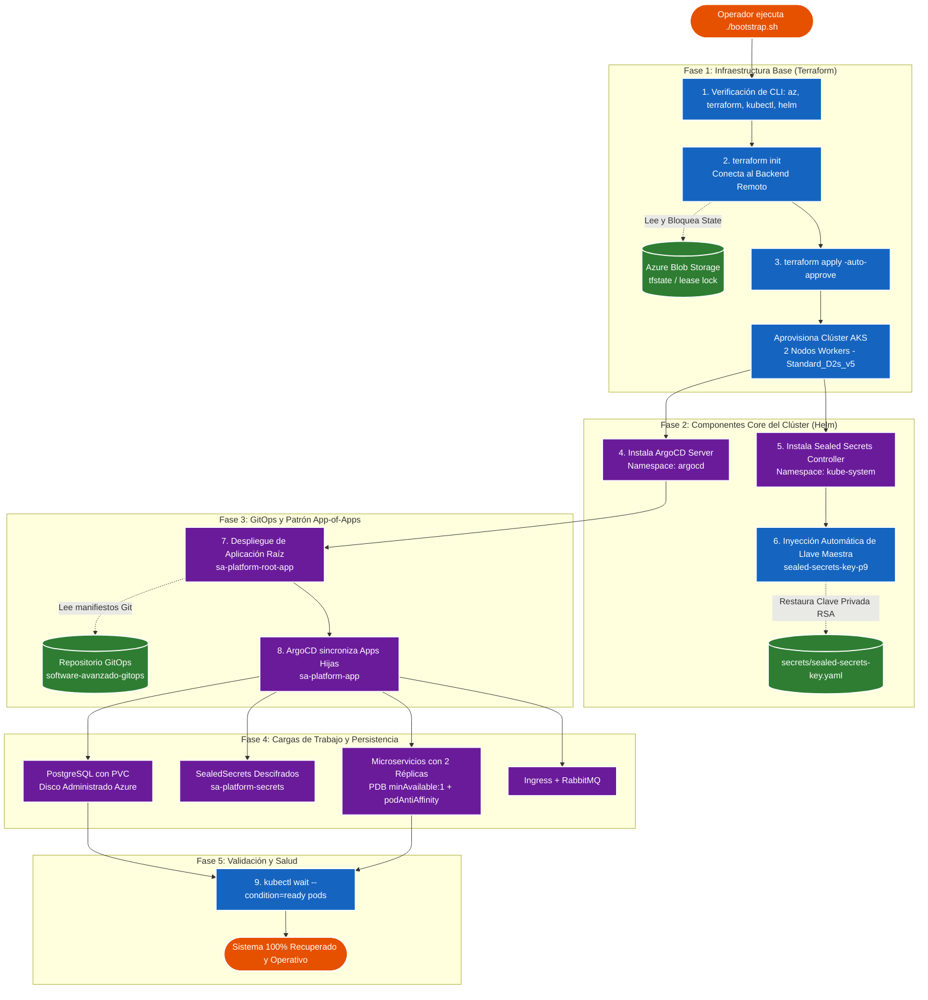

# 📐 Diagrama del Bootstrap de Día Cero y Dependencias de Reconstrucción

**Universidad San Carlos de Guatemala — Facultad de Ingeniería**  
**Escuela de Ciencias y Sistemas — Sistemas Avanzados (2S 2026)**  
**Carnet:** 201712620 | **Estudiante:** Luis Andres Calvo

---

## 1. Orden de Reconstrucción y Dependencias entre Componentes

El proceso de **Bootstrap de Día Cero** garantiza la recuperación total del entorno ante un desastre catastrófico a partir de un único punto de entrada (`P9/bootstrap.sh`).

A continuación se ilustra la arquitectura de reconstrucción, diferenciando con claridad las acciones **automáticas** (ejecutadas por Terraform, scripts y ArgoCD) de las acciones **manuales** iniciales (disparar el script de entrada y proveer credenciales).

---

## 2. Clasificación de Tareas: Automático vs. Manual

| Componente / Paso | Tipo de Ejecución | Responsable | Mecanismo de Control |
|---|---|---|---|
| **Disparo del proceso** | 🟠 **Manual** | Operador SRE | Ejecución de `./bootstrap.sh` |
| **Bloqueo y lectura de estado** | 🔵 **Automático** | Terraform | Backend remoto `azurerm` con Lease Locking |
| **Aprovisionamiento de AKS** | 🔵 **Automático** | Terraform | Provider AzureRM |
| **Instalación de ArgoCD** | 🔵 **Automático** | Terraform / Helm | Helm Release `argo-cd` |
| **Instalación de Sealed Secrets** | 🔵 **Automático** | Terraform / Helm | Helm Release `sealed-secrets` |
| **Restauración de clave de secretos** | 🔵 **Automático** | `bootstrap.sh` | Inyección de Secret con etiquetas de Bitnami |
| **Despliegue de App-of-Apps** | 🔵 **Automático** | Terraform / Helm | Helm Release `root-app` |
| **Sincronización de Microservicios** | 🔵 **Automático** | ArgoCD | Auto-sync con `prune` y `selfHeal` |
| **Verificación de disponibilidad** | 🔵 **Automático** | `bootstrap.sh` | Probes de readiness y `kubectl wait` |

---

## 3. Matriz de Dependencias

1. **AKS Clúster** depende del **Resource Group** y **Red Virtual**.
2. **ArgoCD y Sealed Secrets** dependen de la disponibilidad del **API Server de Kubernetes**.
3. **Descifrado de Secretos** depende de la inyección previa de la **Llave Maestra RSA**.
4. **Microservicios (Pods)** dependen de la existencia de los **Secretos descifrados** (`sa-platform-secrets`) y la base de datos PostgreSQL.
5. **App-of-Apps** orquesta la convergencia final garantizando el orden de despliegue mediante políticas de sincronización de ArgoCD.
